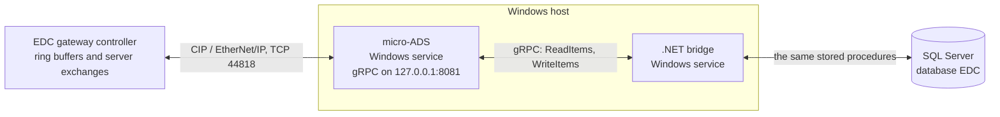
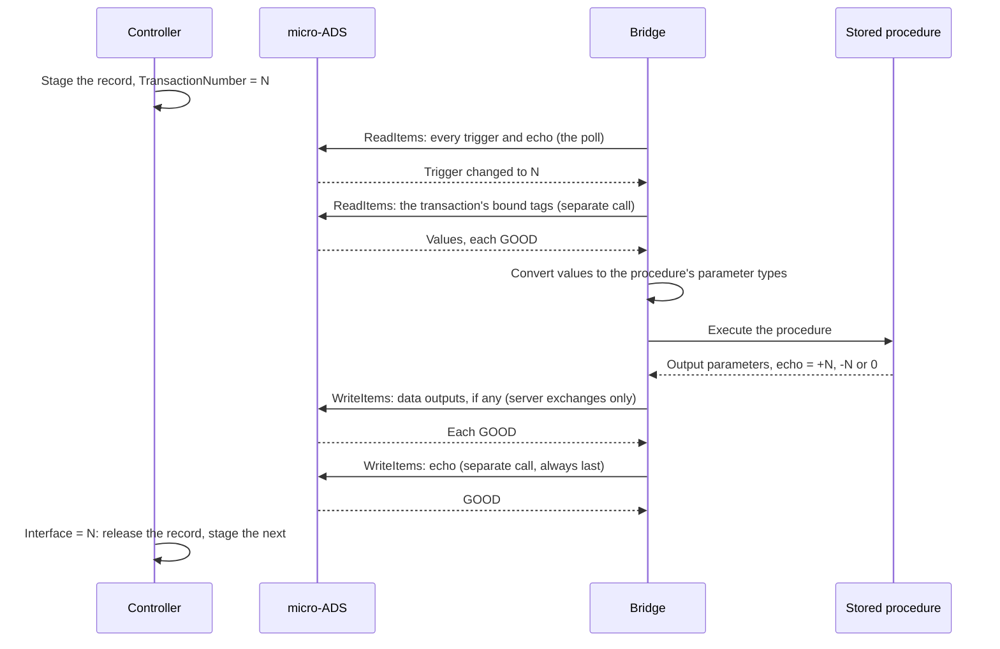

# edc-data-logger: a micro-ADS relay in place of Transaction Manager

## Purpose

The EDC gateway controller (`eAssy_EDC_Gway.ACD`) sends its equipment data to SQL Server through
FactoryTalk Transaction Manager. This project replaces Transaction Manager with a C#/.NET service,
the **bridge**. The bridge reaches the controller through Rockwell Digital Platform micro-ADS (from the
Werewolf Embedded bundle) and calls the same stored procedures.

**Nothing else changes.** The controller logic, the UDTs, the ring buffers, the stored procedures,
the tables and the processing jobs stay as they are. [RING-BUFFER.md](RING-BUFFER.md) describes all
of them, and it is the basis of this design.

**Decided 6 November 2026.** This replaces an earlier draft that designed a new logger with its own
controller queue, window protocol and database. That draft rested on two decisions of 31 October (a
new database, and a rate over 10 events per second). Both are superseded: the database is the
existing EDC database, and the rates are whatever the gateway produces today.

**Status:** design, no code yet. The micro-ADS behaviour relied on comes from the digip-wiki
(`services/microads/data-service.md`, `data-service-reference.md`, `concepts/cip-data-types.md`) and
from the lab work on `andon-ads-mdi-gw` (October 2026), which runs on the same micro-ADS build.
[INTERFACE-SPEC.md](INTERFACE-SPEC.md) gives the concrete definitions, configuration and lab checks.

**Contents**

1. [What Transaction Manager does](#1-what-transaction-manager-does)
2. [Scope](#2-scope)
3. [Deployment](#3-deployment)
4. [Responsibility boundaries](#4-responsibility-boundaries)
5. [The relay cycle](#5-the-relay-cycle)
6. [Reading safely](#6-reading-safely)
7. [Writing the answer](#7-writing-the-answer)
8. [Values and types](#8-values-and-types)
9. [Failures](#9-failures)
10. [Running beside Transaction Manager, and cutting over](#10-running-beside-transaction-manager-and-cutting-over)
11. [Throughput and micro-ADS capacity](#11-throughput-and-micro-ads-capacity)
12. [.NET application structure](#12-net-application-structure)
13. [Operations and security](#13-operations-and-security)
14. [Acceptance scenarios](#14-acceptance-scenarios)
15. [Open decisions](#15-open-decisions)
16. [References](#16-references)

---

## 1. What Transaction Manager does

Transaction Manager keeps no state and buffers nothing. Each of its transactions does four things:

1. It watches one controller tag, the **trigger** (`TransactionNumber`), and fires when it changes.
2. It reads the tags bound to the procedure's input parameters.
3. It calls the stored procedure.
4. It writes the procedure's output parameters back to the tags bound to them. The last of these is
   the **echo**: the transaction number, returned by the procedure, written to `Interface`.

The controller does all the queueing. A ring buffer keeps its record in the staging tag and does not
move its read pointer until `Interface` equals the current `TransactionNumber`. With no answer, or a
wrong one, it sends the same record again under a new number (RING-BUFFER.md, section 4). So if the
relay stops, loses an answer or restarts, nothing is lost: the record is still in the controller.

The bridge copies this exactly. **It holds no queue, no record and no state that has to survive a
restart.** Everything it needs comes from the controller each time a trigger fires.

---

## 2. Scope

Transaction Manager's configuration `EDC` (`design/EDC.xml`) has 26 transactions. All 26 follow the
pattern in section 1:

| Group | Count | Direction | Bridge scope |
|---|---|---|---|
| Ring buffer stores: Fault 01–06, Quality 01–04, Trend 01–02, Summary 01–02, Cycle 01–02 | 16 | Controller to SQL | **Phase 1** |
| Line status, `LddLineStatus` | 1 | Controller to SQL | Phase 2 |
| Server exchanges: status, health, configuration, PdM configuration, ignore masks | 5 | SQL to controller | Phase 3 |
| Track ring buffers 01–04 | 4 | Disabled in Transaction Manager | Not carried over |

The bridge is a **general relay driven by transaction definitions**, not code written for each
transaction. A definition names the trigger, the echo, the procedure, and each parameter's source
or destination. Definitions are generated from `EDC.xml` (INTERFACE-SPEC.md, section 2), so the 22
enabled transactions need no hand-written mapping. A later logger with new ladder and a new procedure
would need only one new definition.

---

## 3. Deployment

### Option A: Windows host (recommended)

This is how the ADS MDI Gateway runs (`andon-ads-mdi-gw`, `docs/INSTALL.md`):

- micro-ADS runs as a Windows service from the Werewolf Embedded Windows bundle, listening on
  `127.0.0.1:8081` only;
- the bridge runs as a second Windows service beside it;
- SQL Server is the existing EDC server, reached over the network as Transaction Manager reaches it
  today.



Why this is the default:

- **It is proven.** This micro-ADS build (bundle `v5.0.0`, micro-ADS `v8.0.1`) has been through
  power-cycle, micro-ADS-restart and SQL-outage testing in the lab on Windows.
- **It fits where Transaction Manager runs.** The host can be the Transaction Manager server or one
  beside it, with the same network path to the controller and to SQL Server.
- **The micro-ADS endpoint stays on loopback.** Its gRPC API has no authentication or encryption.

Give the bridge **its own micro-ADS**, not one shared with another application. All requests to one
micro-ADS are serialized behind a single plugin lock (wiki: *Concurrent clients serialize on one
plugin write lock*), and the bridge's load is high (section 11).

micro-ADS needs network access to the controller on TCP 44818. Data Access also needs the micro-ADS
licensing material (`license_id.txt`; wiki, `services/microads/cip-ds.md`).

### Option B: Linux container

micro-ADS and the bridge can run as two containers on a private network, with the bridge reaching
micro-ADS at `http://werewolf:8081`. Check the Werewolf OCI artifact's qualification and support
status first. Nothing in the bridge depends on the choice; the endpoint is configuration.

---

## 4. Responsibility boundaries

| Component | Responsibility |
|---|---|
| Controller | Everything that queues, orders, retries and releases: the ring buffers, the staging record, the transaction number, the timeouts, the keep-alive, the server-exchange requests. **Unchanged.** |
| micro-ADS | CIP access to controller tags through `ReadItems` and `WriteItems`. It does not order the items in one call or make them atomic. |
| Bridge | Detects triggers, reads the bound tags, converts the values, calls the procedure, writes the outputs and then the echo. Holds no records. |
| Stored procedures | Store or answer, and decide the echo: +N, -N or 0 (RING-BUFFER.md, section 8). **Unchanged.** |
| SQL processing jobs | Turn stored rows into events. **Unchanged.** |

---

## 5. The relay cycle



The bridge keeps five rules. Each one replaces something Transaction Manager did without being told.

1. **One call in flight per transaction.** A transaction's next trigger is not handled until its
   current one has finished: answered, failed or abandoned. Different transactions run in
   parallel. The ring buffer procedures' duplicate check takes no locks, so two calls for the same
   record could both insert.
2. **Answer the number that was read.** The echo the bridge writes is the procedure's output for
   that call. The controller ignores an echo that no longer matches its current number, so a late
   answer is harmless.
3. **Read the trigger first, the data second, in separate calls** (section 6).
4. **Write the echo last, in its own call,** after every other output has been written and checked
   (section 7).
5. **Convert types as Transaction Manager did** (section 8).

---

## 6. Reading safely

micro-ADS does not make a multi-item read a snapshot. A `ReadItems` call becomes CIP Read Tag
requests that can span several packets, with controller scans between them, and item order inside
one call is not preserved (wiki: *Write ordering*; this design assumes reads behave the same).

The relay does not need a snapshot, because the controller keeps the data still:

- A ring buffer copies the record into the staging tag (`RB_Read`, rung 9) **before** it changes
  `TransactionNumber` (rung 10), in the same scan. The staging tag does not change again until
  `Interface` matches the number. Only the bridge writes `Interface` (section 10). So once the
  bridge has read a new N, any read it starts **afterwards** returns that record, however many
  packets and scans it spans.
- That is why the trigger and the data must be **separate, awaited calls, trigger first**. In one
  call, the data items could be read in the scan before the copy and the trigger in the scan after,
  giving the previous record under the new number. The procedure would store that as a duplicate,
  answer +N, and the controller would release a record that was never stored.

Every item must come back GOOD. Test the quality class, not equality with 192, since GOOD has
subcodes. If any item is BAD, do not call the procedure: wait and read again. The controller's
5-second retry will move N on if the problem persists, and the bridge then reads the same record under
the new number.

**Shadow mode is the exception.** While Transaction Manager still answers a transaction (section 10),
the record can change under the bridge. Shadow mode therefore reads the trigger again after the data,
and discards the read if it has changed.

**The server exchanges are assumed to follow the same order:** request members set before the
number changes, and held until answered. Confirm this in `ServerInterface` for each of the five
before phase 3 (INTERFACE-SPEC.md, section 12).

---

## 7. Writing the answer

micro-ADS does not order the items of one `WriteItems` call or make them atomic. The ladder's own
comments show Transaction Manager did not order them either: the status request waits 50 ms after
the echo because Transaction Manager "was receiving Handshake before Data" (RING-BUFFER.md,
section 11).

So the bridge writes in two steps:

1. **Data outputs**, in one `WriteItems` call. Ring buffers have none; the server exchanges have
   3 to 66. Every item must come back GOOD.
2. **The echo**, in a separate `WriteItems` call, only after step 1 succeeded.

micro-ADS specifics:

- **An `Ok` RPC does not mean the writes landed.** Each item has its own quality. The CIP status
  behind a BAD is only in the micro-ADS log.
- **The first write after a controller download fails** with status 535 on a stale connection
  (wiki: *Reading the write result*). Retry a BAD write once. After that, treat it as a failure.
- **If step 1 fails, do not write the echo.** The controller times out and asks again. Writing the
  echo over missing data would make the controller act on stale values.
- **If the echo write fails, do nothing more.** The controller times out and sends the record again
  under a new number, and the procedure's duplicate check makes the repeat harmless.

---

## 8. Values and types

Transaction Manager reads each tag as the type of its data point, and some of those differ from the
Logix type. The INT and SINT members of the records are signed in the controller, but most are read
as unsigned (RING-BUFFER.md, section 7: steps and durations are 0 to 65,535). The bridge must do the
same, or new rows will disagree with the history.

The definitions carry each data point's Transaction Manager type, taken from `EDC.xml`, and the
bridge converts by it. In the 22 enabled transactions:

| Transaction Manager type | Bound data points | Bridge conversion |
|---|---|---|
| `int32` (DINT) | 384 | as read |
| `int16` (INT) | 348 | as read |
| `uint16` (INT read as unsigned) | 496 | `(ushort)(short)value` |
| `int8` (SINT) | 34 | as read |
| `uint8` (SINT read as unsigned) | 296 | `(byte)(sbyte)value` |
| `bool` | 40 | as read |
| `single_flt` (REAL) | 5 | as read |
| `string` (STRING) | 9 | as read |

The converted value is then passed with the procedure parameter's own SQL type. One case needs
care: the cycle record's VIN is 17 one-byte `VARBINARY` parameters (RING-BUFFER.md, section 8.1).
The bridge passes a one-byte array; shadow mode (section 10) checks that the stored VIN matches.

The other bindings:

- **`@input_TMTimeStamp`** is Transaction Manager's `TransTimestamp("local")`, its host's local
  clock. The bridge passes its own host's local time. The host's time zone must match the
  Transaction Manager server's.
- **`@input_ShopID`** is the constant 1 in every transaction. Constants come from the definition.
- **`@RETURN_VALUE`** is not bound to anything and is ignored.
- **Input/output parameters** (the outputs) are read from the controller and passed in as their
  input values, as Transaction Manager does, then written back from their output values.

micro-ADS limits (wiki: *CIP Data Types*, *Data Service*): a structure or array cannot be read as one
item, so every member and element is its own item; never use the `,L<n>` element-count modifier;
`Vqt.t` is the micro-ADS host's read time, not a controller time.

---

## 9. Failures

| Failure | What the bridge does | What the controller does |
|---|---|---|
| SQL Server unreachable, or the call fails or times out | Logs it. Writes nothing. Backs off before that transaction's next call. | Retries the same record after 5 s, under a new number. |
| The procedure returns -N | Writes -N, as returned. | Retries after 2 s. |
| The procedure returns 0 | Writes 0. | No match; retries after 5 s. |
| Error 266 (transaction count mismatch; RING-BUFFER.md, section 8.1) | Treats it as a failed call; writes nothing. The connection goes back to the pool, whose reset rolls back the open transaction. | Retries; the procedure stores the record cleanly. |
| A BAD read | Does not call the procedure. Reads again after a short wait. | Retries after 5 s if nothing answers. |
| A BAD write, after one retry | Stops that answer. The echo is never written over failed data. | Retries. |
| micro-ADS unreachable (`UNAVAILABLE`) | Reconnects with bounded backoff, then starts from a fresh poll. | Retries every 5 s; records wait in the ring buffer. |
| Controller unreachable | Every item reads BAD: waits. | — |
| Controller back after an outage | Reads should return GOOD again on their own. **Unproven for `ReadItems`.** On `andon-ads-mdi-gw`, subscription items created while the controller was off stayed broken after it returned. A replacement subscription that overlapped them delivered one tag's value under other items' IDs, with GOOD quality. If reads stay BAD after the controller is back, an alarm is raised and the bridge reconnects to micro-ADS. A wrong value with GOOD quality cannot be detected in general, so lab check 12 (INTERFACE-SPEC.md) has to rule it out. | Retries; records wait. |
| Controller downloaded | The first write may fail with 535: retry once. | Pointers take the downloaded values (RING-BUFFER.md, section 6). |
| Bridge restarts | Starts from a fresh poll. Any transaction whose echo does not equal its trigger is answered. | The record is still staged. |
| An echo changes that the bridge did not write | Another client is answering: alarm, and stop that transaction's worker. | — |

The bridge never writes an answer it did not get from the procedure. Where Transaction Manager's own
behaviour on an SQL error is unknown, the bridge writes nothing and leaves the retry to the
controller's timers.

---

## 10. Running beside Transaction Manager, and cutting over

**Never let the bridge and Transaction Manager answer the same transaction.** Both would call the
procedure, and both would write the echo. The bridge watches for this: its poll reads every echo, and
an echo that changes without the bridge writing it means another writer (section 9).

Cut over one transaction at a time, in four stages:

1. **Shadow.** Transaction Manager answers. The bridge watches the trigger, reads the record,
   converts it and records the parameter set it *would* have sent, without calling the procedure or
   writing anything. A comparison against the rows Transaction Manager stored proves the reads, the
   conversions and the VIN. This needs no change to the controller or Transaction Manager, and can
   run in production.
2. **Live, one ring buffer.** Disable that transaction in Transaction Manager, then enable it in the
   bridge. Start with a quiet buffer, such as `RB_Cycle02` or `RB_Sum02`.
3. **The remaining ring buffers,** then `LddLineStatus`.
4. **The server exchanges,** last.

The server exchanges come last because the status exchange controls the release delay. Every ring
buffer releases records with no delay only after the status exchange has answered steadily for
60 s. After any status timeout (12 s with no answer) they slow to 100 ms per record
(RING-BUFFER.md, section 5.1). At the fault buffers' rate (section 11), the slow mode is close to
their throughput limit. Once the bridge owns the status exchange, a bridge restart briefly slows
every ring buffer.

Rollback at any stage is the reverse: disable in the bridge, then re-enable in Transaction Manager.
The controller needs no change either way.

**External access.** The trigger and the bound data must be readable, and the echo and output tags
writable. Transaction Manager already needs the same access, so it is probably set.

---

## 11. Throughput and micro-ADS capacity

This is the main risk in the design, and the first thing to measure.

**The rates.** The busiest buffers are the fault buffers. At the time of the printout, `RB_Fault06`
had counted 344,695 records in the current shift and `RB_Fault04` 318,575. Shifts average about 11
hours, so `RB_Fault06` alone runs at roughly 9 records per second or more. It has also dropped
8,543 messages because it was full (RING-BUFFER.md, section 11). The bridge has to be at least as
fast as Transaction Manager on these buffers. The cycle buffers are slow, about 0.2 records per
second.

**One record per round trip, per buffer.** For a fault record (23 items) the round trip is:

| Step | Estimate |
|---|---|
| Waiting for the next poll | half the poll interval: ~12 ms at 25 ms |
| `ReadItems`, 23 items | ~10–25 ms |
| Procedure | ~5–10 ms |
| `WriteItems`, the echo | ~3 ms |
| The controller's next scan | one MainTask scan (not in the printouts) |
| **Total** | **~30–50 ms: about 20–30 records per second per buffer** |

The estimates use the wiki's measured latencies (one client, L85 controller, Windows 11): 3 ms for a
one-tag write and 6 ms for a read and write. The lab gateway wrote 100 tags in 97 ms. A 23-item read
and a 277-item read have not been measured.

**The aggregate is the real limit.** One micro-ADS handles one request at a time. Every poll, read
and write for all 22 transactions queues behind the same lock. If the six fault buffers together
carry 40 records per second, and each record takes about 25 ms of micro-ADS time, micro-ADS is busy
all the time before any poll is counted.

So the first lab measurement (INTERFACE-SPEC.md, section 12) is micro-ADS's sustained rate for the
real pattern: one trigger poll, then a 23-item read and a one-item write, repeated, with other
transactions running alongside. If one micro-ADS cannot carry the load, the options are:

- **Several micro-ADS instances,** each serving a group of transactions, each with its own
  connection to the controller;
- **a slower poll** for the quiet transactions;
- leaving some transactions on Transaction Manager.

The gateway's built-in test sources can provide the load in the lab (RING-BUFFER.md, section 2.7).

**Polling, not subscriptions.** The bridge polls every trigger and echo in one `ReadItems` call, at
25 ms to match Transaction Manager. Subscriptions would save the idle polls, but on the gateway they
are where the micro-ADS defects appeared: items broken after a controller outage, and values
delivered under the wrong IDs. A wrongly delivered trigger could fire a read of the wrong record.

---

## 12. .NET application structure

A **.NET Worker Service** (`Microsoft.Extensions.Hosting`):

| Concern | Choice | Notes |
|---|---|---|
| Target | `net10.0` (LTS) | |
| Hosting | `UseWindowsService()` (Option A), or a container (Option B) | A worker registers itself as a Windows service; no nssm needed. |
| gRPC | `Grpc.Net.Client`, stubs generated by `Grpc.Tools` from the bundle's `grpc_definitions` | Plain `http://127.0.0.1:8081` (h2c). Copy `grpc_definitions` from the bundle, as the gateway does, and refresh it when micro-ADS is upgraded. |
| SQL | `Microsoft.Data.SqlClient` | `CommandType.StoredProcedure`, typed parameters from the definition, a pooled connection per call, no outer transaction. |
| Definitions | JSON generated from `EDC.xml` by a small tool in this repo | Checked into the repo and reviewed like code. |
| Config | `appsettings.json`: endpoint, controller route, timings, which transactions are live or shadow | SQL credentials from the environment, never the file. |
| Logging | `Microsoft.Extensions.Logging`, to a rolling file | State changes at Information; one line per cycle at Debug. A scope per cycle carries the transaction and N. |
| Telemetry | OpenTelemetry: a trace per cycle, metrics for every cycle and micro-ADS call, the controller's own backlog and drop counters, logs over OTLP | **Off by default**; a bad setting never stops the bridge. Section 13 gives the reasons, INTERFACE-SPEC.md section 8 the detail. micro-ADS can export spans of its own, but it ships with that off, and its traces do not continue the bridge's. |

Structure:

- **One poller.** One `ReadItems` call per poll covers every live transaction's trigger and echo. It
  hands each changed trigger to that transaction's worker.
- **One worker per transaction.** It runs one cycle at a time (section 5). If its trigger changes
  again while it is busy, it takes the latest value when it finishes.
- **Shared** gRPC channel and SQL connection pool.

```text
Poller, every PollMs:
    ReadItems(all triggers and echoes)
    For each transaction: if an echo changed and the bridge did not write it, alarm and stop that worker.
    For each transaction: if its trigger differs from the last value handled, signal its worker.

Worker, for each signal (one at a time):
    N = latest trigger value.
    ReadItems(bound tags).            Any BAD: wait RetryReadMs, read again, while N is still current.
    Convert to parameters.            Shadow: record the parameters and stop here.
    Execute the procedure.            Failure: log, back off, stop here (write nothing).
    WriteItems(data outputs).         Any BAD after one retry: stop here.
    WriteItems(echo).                 BAD after one retry: stop here.
    Remember N as handled.
```

---

## 13. Operations and security

- **Alarms already exist in the controller.** `BufferAlarm`, the not-empty timer, the transaction log
  codes and the status counters (RING-BUFFER.md, section 9) show a stalled relay on the HMI without
  any bridge involvement. They stay the primary alarm.
- **Bridge health** is its telemetry (section 13.1), plus the Windows service state.
- **Credentials:** keep SQL credentials out of the repo. Use a login with `EXECUTE` on the 22
  procedures only, or the service account with Windows authentication.
- **Encryption:** `Microsoft.Data.SqlClient` encrypts by default, so the server certificate must
  validate or be explicitly trusted. Transaction Manager's ODBC connection (`DSN_TMMI_EDC`) shows
  what the server accepts today.
- **micro-ADS** listens on loopback only (Option A) or a private network (Option B). It writes a
  new log file every hour and never deletes one, so the host needs the nightly clean-up task that
  `andon-ads-mdi-gw` installs.

### 13.1 Telemetry

This bridge needs more telemetry than most, for three reasons:

1. **Throughput is the main risk (section 11), and only measurements settle it.** The poll interval
   and the time of each micro-ADS call show micro-ADS saturating before any record backs up. The
   same numbers that settle lab check 5 then keep watching it in production.
2. **The controller already measures backlog and loss,** and only the HMI shows them. The bridge
   reads each ring buffer's `RecordCount` and `WriteBlockErrCnt` every 10 s and keeps them as time
   series. "Is the bridge keeping up?" then has a direct answer, and a dropped message has a time.
3. **One failure is spread across three places:** the bridge, micro-ADS's log (the only place the
   CIP status of a BAD item appears) and the procedure. A trace per cycle, logs joined to it, and
   micro-ADS's log shipped beside them put those in one view.

The design follows the team's OpenTelemetry guide:

- **Off by default.** With telemetry off, the bridge adds nothing: no extra controller reads, and
  every span call is a no-op.
- **A trace per cycle, not per poll.** The poll runs 40 times a second and is covered by metrics.
- **Its own client spans around micro-ADS,** because an `Ok` call can carry BAD items.
- **Metrics complete, traces tail-sampled:** keep every failure, every resend and every slow
  cycle.
- **Record values are not recorded unless their owner agrees:** the cycle record carries a VIN.

Telemetry never holds up a cycle: when its queue is full, it drops data.

The controller's alarms remain the primary alarm. Telemetry explains what they showed; it does not
replace them.

**Transport.** OTLP leaves the host in plain text unless TLS is configured. With record values off
(INTERFACE-SPEC.md, section 8.9) it carries counts, timings and record keys only. Treat it like the
SQL connection, as a decision rather than a default.

---

## 14. Acceptance scenarios

Before each stage of the cutover, demonstrate:

1. **Shadow:** for every record in a test period, the bridge's parameter set matches the row
   Transaction Manager stored, including converted steps and durations above 32,767, SINT values
   above 127, and the VIN.
2. A record is stored once, acknowledged, and released.
3. A SQL outage: the bridge writes nothing, the controller retries, and the backlog drains when SQL
   returns, with no duplicate rows.
4. A bridge stop during a call: on restart, the outstanding record is answered and stored once.
5. A micro-ADS restart: the bridge reconnects and continues.
6. A controller download: the first write's 535 is retried, and relaying resumes.
7. A BAD read never reaches the procedure. A failed data write never produces an echo.
8. An echo written by another client (Transaction Manager left enabled by mistake) raises the alarm
   and stops that worker.
9. **Throughput:** with the gateway's test sources driving the fault buffers above their production
   rate, the bridge keeps up, with no `WriteBlockErrCnt` drops attributable to it.
10. **Server exchanges:** data outputs land before the echo, and the release delay stays at 0 ms
    across normal operation.
11. Reboot of the host with no one logged in: both services start and relaying resumes.
12. A controller power cycle, short and long: reads recover with no restart, and every value is the
    right item's (INTERFACE-SPEC.md, lab check 12).
13. **Telemetry:** with no `Telemetry` section, zero spans and a "telemetry is off" line. With an
    unrecognized exporter name, a warning naming it, and the bridge relaying normally. With the
    console exporter, a cycle trace with its child spans. During the throughput test (9), the poll
    interval, micro-ADS call times and `RecordCount` are visible as they happen.

---

## 15. Open decisions

| # | Decision | Status |
|---|---|---|
| 1 | Scope | **Decided 6 Nov 2026:** replace Transaction Manager; controller, procedures and database unchanged. |
| 2 | Deployment: Option A (Windows) or B (container), and which host | Open. Option A recommended. |
| 3 | One micro-ADS or several | Open. Decided by the capacity measurement (section 11). |
| 4 | How far to go: ring buffers only, or all 22 transactions | Open. Phases 1 to 3 (section 2) allow stopping after any phase. |
| 5 | Who owns the cutover in production, and the Transaction Manager change process | Open. |
| 6 | Whether to fix the procedures' missing rollback (RING-BUFFER.md, section 8.1) | Open. The bridge is protected either way (section 9); Transaction Manager is not. |
| 7 | Where telemetry goes in production | Open. The Digital Platform's LGTM stack is cloud-only and has no edge pattern. Find out what the plant already runs before choosing. Alloy on the bridge host either way (INTERFACE-SPEC.md, section 8.8). |
| 8 | Whether record values, the VIN in particular, may go into telemetry or the shadow file | Open. Off until the data owner decides. |

---

## 16. References

- [RING-BUFFER.md](RING-BUFFER.md): the controller, Transaction Manager and procedure side, in detail.
- `design/EDC.xml`: the Transaction Manager configuration the definitions are generated from.
- digip-wiki, [Data Service](https://github.com/ra-ti-digital-platform/digip-wiki/blob/main/services/microads/data-service.md): write results, write ordering, plugin lock, structures and arrays
- digip-wiki, [Data Service Reference](https://github.com/ra-ti-digital-platform/digip-wiki/blob/main/services/microads/data-service-reference.md): VQT, quality, measured latencies
- digip-wiki, [CIP Data Types](https://github.com/ra-ti-digital-platform/digip-wiki/blob/main/concepts/cip-data-types.md): type mapping, `STRING`, arrays
- digip-wiki, [Device Addressing](https://github.com/ra-ti-digital-platform/digip-wiki/blob/main/concepts/device-addressing.md)
- digip-wiki, [C#/.NET Client Examples](https://github.com/ra-ti-digital-platform/digip-wiki/blob/main/getting-started/csharp-client-examples.md)
- digip-wiki, [Werewolf Quickstart](https://github.com/ra-ti-digital-platform/digip-wiki/blob/main/getting-started/werewolf-quickstart.md)
- digip-wiki, [Logger library](https://github.com/ra-ti-digital-platform/digip-wiki/blob/main/concepts/logger-lib.md) (micro-ADS's `otlp` appender and its start-up panic) and [LGTM Observability Stack](https://github.com/ra-ti-digital-platform/digip-wiki/blob/main/services/observability/lgtm-stack.md) (cloud-only; trace context not continued)
- `opentelemetry-dotnet.md`: the team's guide to adding OpenTelemetry to a .NET service, which section 13.1 and INTERFACE-SPEC.md section 8 follow
- `andon-ads-mdi-gw`: `README.md` (micro-ADS defects found in the lab: power cycle, overlapping subscriptions, SQL outage), `docs/INSTALL.md` (micro-ADS as a Windows service through nssm, its hourly log files and the nightly clean-up), `tools/probe.js` (reads for the lab checks)
- `andon-cgp-mdi-gw`: the CGP gateway `andon-ads-mdi-gw` replaced, and the "provably not worse" standard both work to
