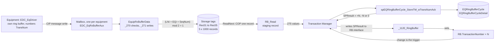
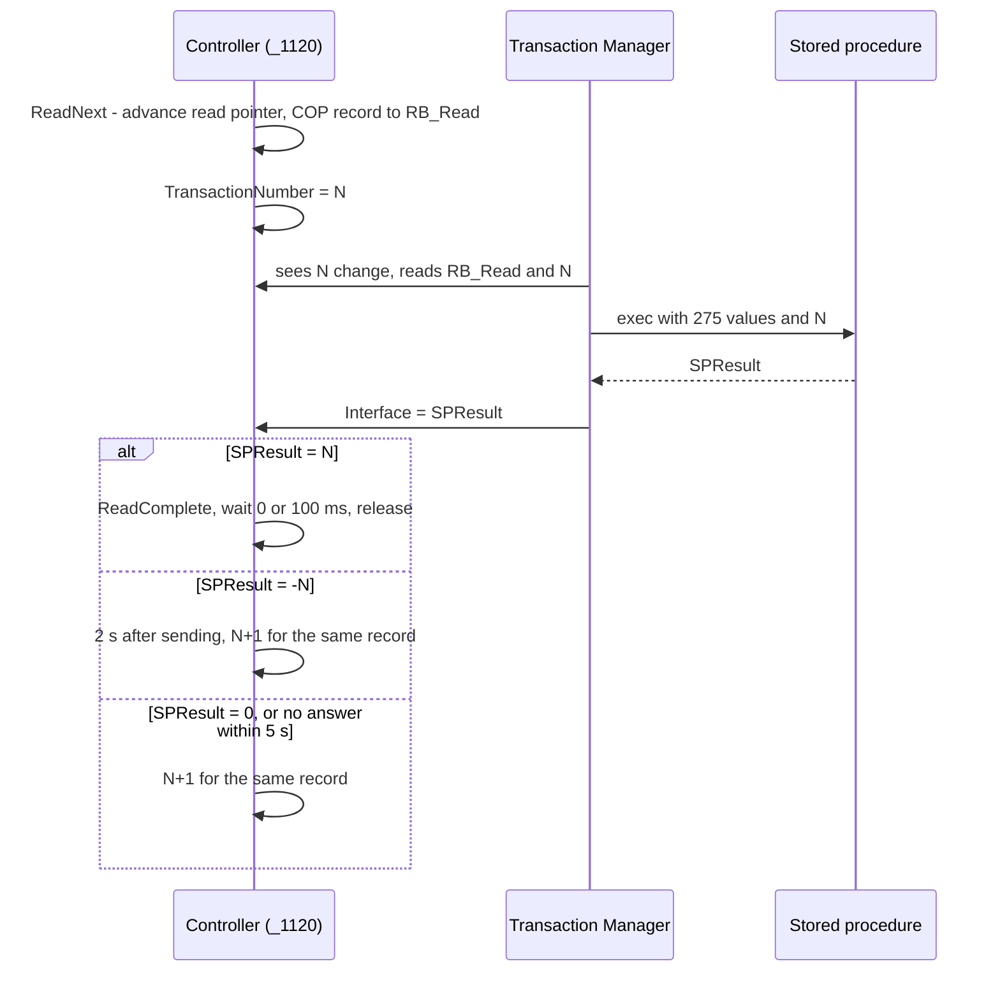
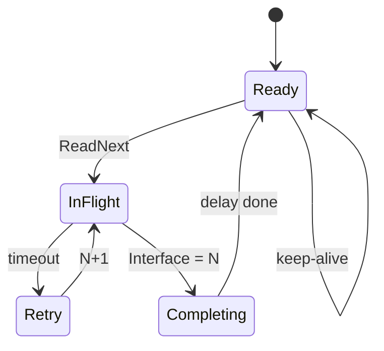

# Ring buffer processing: the EDC model

This document describes how the EDC gateway controller moves equipment messages into SQL Server. The
method has run in production for years, and it is the model for edc-data-logger. It is read from
these sources, captured 1 and 2 November 2026:

- The Logix printout of program `RingBufferCycle01` (MainTask) in `eAssy_EDC_Gway.ACD`, program
  version 3.5.0. It holds six routines: `_1101_Main`, `_1102_Fault`, `_1111_Config`,
  `_1120_RingBuffer`, `_1121_RingBufferKeepAlive` and `_901_TransLogSBR`. This is the reader.
- The Logix printout of program `EquipRxBufferData` (MainTask), also version 3.5.0. It receives the
  equipment messages and writes them into the ring buffers. Its cycle path is `_270_EquipCycleRx`,
  `_271_EquipCycleRxLoadRB01` and `_272_EquipCycleRxLoadRB02`. This is the writer.
- Screenshots of the `RB` tag in `RingBufferCycle01` with its member descriptions, and of the task
  tree.
- The Logix printouts of programs `ServerInterface` (the server exchanges, including the status
  request that sets the release delay, section 5.1) and `EDC_EqDriver` (the equipment driver,
  section 2.6), both version 3.5.0.
- `design/EDC.xml`: the XML export of the whole Transaction Manager configuration `EDC`, exported
  2 November 2026 (section 7).
- The database project `edc-db-edc` (SSDT, version 3.5.0): the store procedures, the tables, and the
  SQL Agent jobs that process the stored rows (section 8.2).
- The FactoryTalk Transaction Manager transaction `EQRingBufferCycle01_StoreTM_wTransNumAck`:
  screenshots of its parameter bindings and its trigger.
- The stored procedure `dbo.spEQRingBufferCycle_StoreTM_wTransNumAck` in database `EDC`.

The current handshake dates from December 2024. Ladder v3.02 replaced the handshake bit with an echo
of the transaction number, and the procedure changed its result from a bit to that echo on
20 December 2024. Older copies named `..._StoreTM_Msg` return a bit and do not match this document.

Rung numbers below refer to the printout. "Rung n" means `_1120_RingBuffer` unless another routine
is named. Section 13 lists what is still outside the printouts.

## 1. The shape

Each ring buffer is its own program, and every program runs the same routines. Inside them, `RB`
refers to that ring buffer's control structure (`EDC.RB_Cycle01` here) and `RB_Read` to its staging
record (`EDC_RB_Cycle01_Read`). `Trans` is `EDC.Trans`, `CFG` is `EDC.CFG` and `CLX` is `EDC.CLX`.
The task tree shows 16 ring buffer programs in MainTask: `RingBufferFault01` to `06`,
`RingBufferQuality01` to `04`, `RingBufferTrend01` and `02`, `RingBufferSum01` and `02`, and
`RingBufferCycle01` and `02`. Transaction Manager has an enabled store transaction for each of the
16 (section 7).

A message passes through three queues on its way to SQL Server:

1. **The equipment's own ring buffer,** kept by the equipment driver `EDC_EqDriver` in each
   equipment controller (20 records for cycle data). The header's `TransNum`, which the procedure
   calls the "Transaction Number from Equipment RingBuffer", is numbered here (section 2.6).
2. **A one-message mailbox per equipment** in the gateway, which the driver fills with a CIP message
   write (section 2.5).
3. **The gateway ring buffer,** read by Transaction Manager (sections 2 to 4).

Both programs run in MainTask, a continuous task, and the task tree shows no other task. Logix runs
the programs of a task one after another, so the writer and the reader never interrupt each other.

### 1.1 The program around the ring buffer

| Routine | Rungs | Role |
|---|---|---|
| `_1101_Main` | 7 | Sets the program version (3.5.0) on first scan. Runs `_1111_Config` on first scan or when `CFG.ConfigONS` is set. Calls `_1120_RingBuffer`. Then records the program scan time, rolls `ShiftCnt` into `PrevShiftCnt` at `ShiftReset`, and counts scans over 100 ms. |
| `_1111_Config` | 5 | Sizes the buffer and repairs a zero `TransactionNumber` (section 2.1). `CFG.ConfigONS` is a one-scan pulse from `Gateway/_009_ConfigInit`, set after a download (`CFG.ConfigAuto`), when someone sets `CFG.ConfigManual`, or after a reset; since v3.02e every reset forces a configuration, to avoid pointer errors from unconfigured arrays. |
| `_1120_RingBuffer` | 23 | The read cycle (section 3). |
| `_1121_RingBufferKeepAlive` | 7 | Writes a keep-alive copy of the last record (section 3.2). |
| `_901_TransLogSBR` | 15 | The transaction log, shared by every caller (section 9). |
| `_1102_Fault` | 7 | The program fault routine. A major fault in this program, such as an array index out of range, is logged with the four pointers, then cleared so the program keeps running. `CFG.DisableFaultHandler` turns that off for testing. |

## 2. Storage and pointers

### 2.1 Storage and configuration

Records live in `MaxTagPtr` array tags (`EDC_RB_Cycle01_Rec01` to `Rec05`). Each tag holds
`MaxRecPtr + 1` records. The storage is split across tags because one Logix tag is limited to 2 MB;
the rung 0 comment reads "supports multiple Tags for Ring Buffers with >2M data".

`_1111_Config` sets the size:

- Rung 2: `MaxRecPtr` is the length of `Rec01` minus 1, found with `SIZE`, so 999. `MaxTagPtr` is
  the constant 5 in the rung. The rung comment requires every storage tag of a buffer to have the
  same length. The buffer has 5,000 slots.
- Rung 3: if `TransactionNumber` is 0, it becomes 1.
- Rung 4: unlatches `WritePtrErr` and `ReadPtrErr`.

The configuration does not reset the pointers, which keep their values across a power cycle (see
section 6).

### 2.2 Pointers

Each position is a pair: a tag pointer from 1 to `MaxTagPtr`, and a record pointer from 0 to
`MaxRecPtr`. To advance a position, add 1 to the record pointer. If it passes `MaxRecPtr`, set it to
0 and add 1 to the tag pointer. If the tag pointer then passes `MaxTagPtr`, set it to 1.

| Tags | Meaning | Printout |
|---|---|---|
| `WriteTagPtr`, `WriteRecPtr` | The next slot the writer will fill. Advanced **after** a write. | 2, 547 |
| `ReadTagPtr`, `ReadRecPtr` | The slot most recently taken for sending, whether it is still in flight or already done. Advanced **before** a read. | 2, 546 |
| `ReadNextTagPtr`, `ReadNextRecPtr` | The slot after the read pointer, worked out on rung 3. | 2, 547 |
| `WritePtr`, `ReadPtr`, `ReadNextPtr` | The same three positions as single numbers: `(TagPtr - 1) * (MaxRecPtr + 1) + RecPtr`, worked out on rung 5. | 1547, 1546, 1547 |

### 2.3 Full and empty (rung 4)

- **Full:** the read position equals the write position. The writer's next slot would be the one
  under the read pointer, which may still be in flight. The slot under the read pointer is never
  overwritten, even after its record has been acknowledged. That one slot is what lets the logic
  tell a full buffer from an empty one.
- **Empty:** `ReadInProgress` is off and the next-read position equals the write position. While a
  record is in flight the buffer is never reported empty.

### 2.4 Record count (rung 6)

`T` below is the slot total, `(MaxRecPtr + 1) * MaxTagPtr`.

| State | Count |
|---|---|
| A record is in flight and `WritePtr > ReadPtr` | `WritePtr - ReadPtr` |
| A record is in flight and `WritePtr <= ReadPtr` | `T - (ReadPtr - WritePtr)` |
| Nothing in flight and `WritePtr >= ReadNextPtr` | `WritePtr - ReadNextPtr` |
| Nothing in flight and `WritePtr < ReadNextPtr` | `T - (ReadNextPtr - WritePtr)` |

So the count includes the record in flight. A full, idle buffer counts `T - 1`. `RecordCountMax`
keeps the largest count seen.

### 2.5 Writing (`EquipRxBufferData`)

Program `EquipRxBufferData` writes every Fault, Quality, Trend and Cycle ring buffer. Each scan it
services 9 of the 29 configured lines (`CfgLineLoopMax` = `CFG.LN.n` / 3, `_211_Config` rung 2), so
each equipment is visited about every third scan. For each configured equipment it runs the receive
routine of each message type that equipment has enabled. The cycle path follows.

**The mailbox (`_270_EquipCycleRx`).** Each equipment writes its cycle message as an unsolicited
message into its own slot, `EDC_EqRxBufferAux.Line[LNi].Equip[EQi].Cycle[]` (134 DINTs). It may send
the next message only when the slot's header `TransNum` is back to 0. The routine copies the slot
into `CycleMsg` with `CPS`, then:

| Rung | Condition | Result | Code |
|---|---|---|---|
| 2 | No message for 330 s (`CFG.BufferMsgTimeout`) | Status error; the slot is cleared | 2504 |
| 4 | Header and footer `TransNum` both 0 | Nothing waiting; exit | |
| 5 | A new message | Restart the transaction timer | 2500 |
| 6 to 8 | Only one of header and footer `TransNum` is set | Wait up to 10 s (`CFG.PartialMsgTimeout`) for the rest, then discard | 2505 |
| 9 | Header and footer `TransNum` differ | Discard | 2506 |
| 10 | Header and footer `TransNum` match | Accept | 2501 |
| 11 | `Header.EQID` is not `LNi × 100 + EQi` | Discard | 2507 |
| 12 | `TransNum` equals the last one accepted | Discard as an equipment keep-alive | 2502 |
| 13 | `TransNum` is not the last one + 1 | Log a sequence error, but load the message anyway, "otherwise this will never recover" | 2509 |
| 14 | Accepted | Choose a ring buffer and load it (below) | |
| 15 | Accepted | Remember `TransNum` and expect the next one, rolling over after 9999 | |
| 16 | Any outcome except "nothing waiting" and "still waiting for the rest" | Copy the message to `EDC_EqRxDataAux` and clear the slot, so the equipment can send again | |

The header and footer `TransNum` frame the message. The equipment writes both, so when they match the
whole message has arrived. It is the same idea as the ring buffer's echo, one stage earlier.

**Choosing the buffer (rung 14).** `BufferID = (LNi + EQi + Data.SeqNum) MOD 2`. A result of 1 goes
to `_271` (`RB_Cycle01`); anything else to `_272` (`RB_Cycle02`). So one equipment's records can
travel through either buffer, and because the two buffers drain independently, SQL Server can
receive them out of order. Fault messages are routed by line instead, `LNi MOD 6` across six
buffers. That was changed back on 4 December 2025 because "all EQID on same Line must go thru same
RB to avoid incorrect Candidate/Event generation for Maximo/PCR". Order matters for fault events, and
the only order this design keeps is the order within one buffer.

**Loading (`_271_EquipCycleRxLoadRB01`; `_272` is the same for `RB_Cycle02`).**

| Rung | What it does |
|---|---|
| 2 | If a write pointer is out of range: latches `WritePtrErr`, saves the pointers in `WritePtrErrTag` and `WritePtrErrRec`, logs 2513, and sets the write position to (1, 0). Unlike the reader's rung 2, it leaves the read position alone. |
| 3 | If the write position equals the read position (`Full`): sets `FullBlockWrite` and `WriteBlockErr`, adds 1 to `WriteBlockErrCnt`, logs 2514, and exits **without writing**. |
| 4 | Copies `CycleMsg` into `Rec0n[WriteRecPtr]`, choosing `n` from `WriteTagPtr`. |
| 5 | Logs 2511 with the four pointers. |
| 6 | Advances the write position. |
| 7 | Adds 1 to `ShiftCnt`. |

What this settles:

- **A full buffer drops the new message.** The equipment released the record when its message
  write completed (section 2.6), and `_270` clears the mailbox afterwards, so nothing upstream knows.
  The loss shows only in `WriteBlockErrCnt` and in code 2514 in the error log. `FullBlockWrite` and `WriteBlockErr` are output coils in a routine that runs
  only when a message arrives, so they keep whatever state the last message left; rely on the
  counter. In this printout `RB_Cycle01`'s counter is 0, but `RB_Fault06`'s is 8,543 (section 11).
- **`CmdNum` is the equipment's, and it is 0.** The cycle path loads the message as received, and
  the equipment driver sets `CycleMsg.Header.CmdNum` to the constant 0 (`_172_CycleDataLoadRB`).
  That is what the database relies on: it discards every row with `Command_Num <> 0` as a keep-alive
  (section 8.2). (The Quality path uses negative values as PdM commands: it does not load -11, and it
  clears -12 and -13 to 0 before loading.)
- **`ShiftCnt` counts records written** by the load routine. Keep-alive copies (section 3.2) are not
  counted.
- **No race with the keep-alive.** The writer and `_1121` are in the same task (section 1), so they
  cannot write the same slot.

The Sum buffers are written the same way by program `EquipRxLiveCallout` (`_151_SumLoadRB01`,
`_152_SumLoadRB02`), with the same full check and `ShiftCnt` count.

### 2.6 The equipment driver (`EDC_EqDriver`)

`EDC_EqDriver` runs in each equipment controller. (The gateway also runs a copy, configured as
equipment 6, which is how this printout was made.) For cycle data it uses three routines:

- **`_171_CycleDataCollect`** times each step of a cycle and fills the step and duration arrays.
- **`_172_CycleDataLoadRB`** builds the message and writes it into the equipment's ring buffer,
  `CycleRB`, of `CFG.CycleRB.n` = 20 records. `Header.TransNum` comes from the buffer's own
  `TransactionNumber` (1 to 9999), `Header.CmdNum` is the constant 0 and `Header.EQID` comes from the
  driver's configuration. When the buffer is full it refuses the write and counts it in
  `WriteBlockErrCnt`, like the gateway (the rung text is the same).
- **`_173_CycleRingBuffer` and `_174_CycleDataMsg`** send the records to the gateway, one at a time,
  with the same pointer logic as the gateway ring buffer.

Sending one record:

1. **Read the mailbox.** A CIP message read of the gateway slot (`CFG.MsgDest.CycleDest`). If the
   header and footer `TransNum` are both 0, the slot is free. If not, wait and read again. The wait
   adapts between 100 and 500 ms (`CfgRB.ReadDelayMin`, `ReadDelayMax`), so a driver that sends faster
   than the gateway can process does not flood it with reads.
2. **Write the record** into the slot with a CIP message write.
3. **Release the record** from the equipment's buffer when the write completes, then take the next
   one. The driver does not wait for the gateway to accept it.

The release point matters. Anything `_270` discards (a partial message, a header and footer
mismatch, a wrong EQID) or `_271` drops (a full gateway buffer) is lost. The equipment's buffer only
protects against the gateway being unreachable or slow to clear the slot, not against what the
gateway does with the message.

**The equipment keep-alive.** After `CFG.BuffMsgResendTime` (301 s) with nothing to send, the driver
resends the last record **without** a new `TransNum`. The gateway recognizes the repeat and discards
it (code 2502), so it only refreshes the gateway's 330 s mailbox timeout (code 2504). It is separate
from the gateway's own keep-alive (section 3.2), which does reach SQL Server.

### 2.7 Test sources inside the gateway

The gateway has no logic that simulates a ring buffer itself: nothing other than Transaction Manager
writes a ring buffer's `Interface`. What it has is a complete equipment driver, program
`EDC_EqDriver` in MainTask ("EqDriver embedded in Logix Controller"), configured as equipment 6
(`UserCfg.EQID`). It sends its messages over the network to the gateway's own mailbox, so they take
the full production path: mailbox checks, ring buffer, Transaction Manager, procedure. It carries
three generators:

| Where | What it generates | State in the printout |
|---|---|---|
| `_800_SimFault` | Fault messages. `SimFault.EN` replaces the mapped fault inputs with test patterns. `Test1EN` sets and clears each configured fault bit in turn; `Test2EN` sets every bit in turn, then clears them in turn. Each test starts after a 60 s delay and steps once per interval. | Enable bits are set by hand. |
| `_094_USER_LogixTools` | Quality messages for test tools. `Tool02` starts and sends a tool record every 20 s (`Tool02_TMR`). | Running if `Tool02_Enable` is on. |
| `_093_USER_LogixFaults` rung 67 | "Generate a bunch of data very fast to test the 10-record batch Fault Event driver": toggles one fault bit on a timer, 12 times. | Disabled (AFI). |

As printed, this driver has fault and quality messages enabled and trend and cycle messages disabled
(`_092_USER_LogixRemote`), so it does not exercise the cycle buffers. Setting `UserCfg.CycleMsgEN`
and supplying cycle data in `_096_USER_LogixCycles` would.

For bridge testing this is the natural load source: it produces real messages through the real
path. Its EQID decides the buffer. Equipment 6 is on line 0, and `0 MOD 6 = 0` matches none of
`RB_Fault01` to `05`, so its fault messages go to `RB_Fault06` (section 2.5). Its quality messages go
to the buffer chosen by `(LNi + EQi + ToolNum) MOD 4`.

## 3. The read cycle, rung by rung

| Rung | When | What it does |
|---|---|---|
| 0 | | Comment only. |
| 1 | Always | Records the routine number and counts scans, for fault diagnostics. |
| 2 | Either read pointer is out of range | Latches `ReadPtrErr` and saves the bad pointers. Logs code 2523. Resets the buffer to empty: write position (1, 0), read position (`MaxTagPtr`, `MaxRecPtr`). Anything buffered is abandoned. The comment says this "should never happen". |
| 3 | Always | Works out the next-read position from the read position. |
| 4 | Always | Sets `Full` and `Empty`. |
| 5 | Always | Works out the single-number pointers. |
| 6 | Always | Sets `RecordCount` and `RecordCountMax`. |
| 7 | Not `Empty` and not `ReadInProgress` | Sets `ReadNext`, latches `ReadInProgress` and unlatches `ReadComplete`. `ReadNext` lasts exactly one scan, because the latch made on this rung blocks the rung on the next scan. (Change DHF019 removed a one-shot here: it "allowed ReadNext to hang on power up".) |
| 8 | `ReadNext` | Advances the read position onto the record to send. |
| 9 | `ReadNext` | Copies (`COP`) that record from `Rec0n[ReadRecPtr]` into `RB_Read`. There is one branch per storage tag. |
| 10 | `ReadNext` or `ReadInProgressTimeout` | Adds 1 to `TransactionNumber`; after `CFG.MsgTransNumRollover` (9999) it goes back to 1. This change is Transaction Manager's trigger. |
| 11 | `ReadNext` or `ReadInProgressTimeout` | Splits `Header.EQID` into a line and an equipment index (EQID = line × 100 + equipment). Sets `ReadValidEQID` if both are within the configured limits. |
| 12 | `ReadValidEQID` | Copies that equipment's status into working tags. |
| 13 | `ReadNext` or `ReadInProgressTimeout` | Logs code 2520 (sent) and starts the performance timer. |
| 14 | `ReadInProgress` | If `Interface = TransactionNumber`, latches `ReadComplete`. If `Interface = -TransactionNumber`, latches `ReadResend`. |
| 15 | `ReadComplete` | Runs the release delay: 0 ms (`CfgRbDelayFast`) once `ServerStat_TMokTMR.DN` shows Transaction Manager healthy, 100 ms (`CfgRbDelaySlow`) otherwise. When it is done, sets `ReadCompleteDelay` and unlatches `ReadInProgress`. |
| 16 | `ReadComplete`, one shot | Sets the status `CycleTxOK`. Logs code 2521 (complete). Records the elapsed time from `ReadInProgressTMR.ACC` as a performance result. |
| 17 | `ReadInProgress` and not `ReadComplete` | Runs the retry timer `ReadInProgressTMR`: 5,000 ms, or 2,000 ms while the answer is "resend". When it is done, sets `ReadInProgressTimeout`. |
| 18 | `ReadInProgressTimeout` | Sets the status `CycleTxER`. Logs code 2524 (timeout). Records a performance error. Resets the retry timer. |
| 19 | `ReadCompleteDelay` and `Empty` | Runs the keep-alive timer, 300,000 ms. When it is done, calls `_1121_RingBufferKeepAlive` (section 3.2) and resets the timer. |
| 20 | Not `Empty` | Runs the not-empty timer, 300,000 ms. `NotEmptyMax` keeps the longest time seen. |
| 21 | `Full`, or the not-empty timer done | Sets `BufferAlarm`. |
| 22 | `ReadValidEQID` | Copies the status working tags back into the status arrays. |

`ReadComplete` stays latched after the last acknowledgment until the next `ReadNext`, so
`ReadCompleteDelay` stays on while the buffer is idle. That is what lets rung 19 time the idle
period. A buffer stuck retrying never sends a keep-alive.

### 3.1 Rung order matters

Three behaviours depend on the order of the rungs within a scan. Keep that order in any port.

- **A retry is sent once, one scan after the timeout.** Rung 17 sets `ReadInProgressTimeout` in scan
  N, and rung 18 resets the timer in the same scan. Rungs 10, 11 and 13 come earlier, so they first
  see the timeout in scan N+1. Rung 17 then clears it in scan N+1. As a result,
  `TransactionNumber` goes up exactly once per timeout.
- **"Resend" shortens the retry time for as long as it is the answer.** Rung 14 latches
  `ReadResend` again on every scan while `Interface = -TransactionNumber`. Rung 17 unlatches it and
  loads the 2,000 ms preset on every scan. So the 2 s preset holds until the number changes.
- **The completion time is captured before it is lost.** In the scan in which `ReadComplete`
  latches, rung 16 reads `ReadInProgressTMR.ACC` first. Only after that does rung 17 go false and
  reset the timer.

A retry does not touch the pointers or `RB_Read`. The same record goes out again under a new
transaction number.

### 3.2 The keep-alive (`_1121_RingBufferKeepAlive`)

The keep-alive does not send anything itself. It writes a copy of the last record into the buffer,
and the normal read cycle sends it.

| Rung | What it does |
|---|---|
| 0, 1 | Comment; routine number and scan count. |
| 2 | Copies the record under the read pointer (the last one sent) into `KeepAliveMsg`. |
| 3 | Adds 1 to `KeepAliveMsg.Header.CmdNum`, wrapping from 9999 to 1 (change DHF024, March 2019). |
| 4 | Copies `KeepAliveMsg` into the slot under the write pointer. |
| 5 | Logs code 2522 and records a keep-alive performance result (`EquipStatus04.CycleTx.KA`) with the idle time from `KeepAliveTMR.ACC`. |
| 6 | Advances the write position. |

On the next scan the buffer is no longer empty, so rung 7 takes the copy and sends it like any other
record. Each copy is copied from the previous one, so `CmdNum` counts 1, 2, 3 and so on through an
idle period.

`CmdNum` is what tells a keep-alive from a repeat. The rung 3 comment says it is "used by TM Stored
Procedure to detect difference between Keep Alive and Duplicate". `Command_Num` is part of the
procedure's duplicate key (section 8), so each keep-alive is stored as its own row. The rung 19
comment, "Server will discard duplicate Transaction Numbers", describes an earlier procedure.

`_1121` writes without checking `Full`. That is safe: it runs only while the buffer is empty, and the
writer, being in the same task, cannot write at the same time (section 2.5).

## 4. The handshake

Transaction Manager writes the procedure's output parameter to `Interface` unchanged. The procedure
does the signing.

| Transition | Condition | Action |
|---|---|---|
| ReadNext | Not `Empty` | Advance the read pointer, copy the record, N+1 |
| timeout | `Interface = -N` for 2 s, or anything else (no answer, or 0) for 5 s | Log 2524, reset the retry timer |
| N+1 | The next scan (section 3.1) | N+1 for the same record |
| Interface = N | The acknowledgment arrives | Latch `ReadComplete` |
| delay done | The release delay ends (0 or 100 ms) | Unlatch `ReadInProgress` |
| keep-alive | `Empty` for 5 minutes after an acknowledgment | Write a copy of the last record with `CmdNum + 1`; it leaves `Ready` at the next `ReadNext` |

## 5. Timing and constants

| What | Value | Where |
|---|---|---|
| Retry when there is no answer, or the answer is 0 | 5 s (the rung comment says it was reduced from 62 s) | Rung 17 |
| Retry after a "resend" answer | 2 s after the send | Rung 17 |
| Delay before the next record | 0 ms while Transaction Manager is healthy, 100 ms otherwise (section 5.1) | Rung 15: `CfgRbDelayFast`, `CfgRbDelaySlow`, `ServerStat_TMokTMR` |
| Keep-alive | After 5 min idle | Rung 19 |
| Keep-alive `CmdNum` | 1 to 9999 | `_1121` rung 3 |
| Not-empty alarm | After 5 min | Rungs 20 and 21 |
| `TransactionNumber` range | 1 to 9999. It is never 0, so a 0 answer never matches. | Rung 10, `CFG.MsgTransNumRollover`; `_1111_Config` rung 3 |
| Transaction Manager's own timeout | 1 minute | Transaction options |
| Scan-time warning | Program scans over 100 ms are counted | `_1101_Main` rung 6 |

The rung 15 comments give the history of the delay. It was first added because resetting the
handshake bit too soon caused a Transaction Manager error on its read verify. The v3.02 echo removed
that need. A short delay was kept because no delay at all caused Transaction Manager thread errors.

### 5.1 What "Transaction Manager healthy" means

`ServerStat_TMokTMR` is a 60-second timer on rung 12 of `ServerInterface/_860_StatRequest`. Its
comment: "use the Server Status Message to monitor TM status. If TM communications stop, throttle RB
speed until it has recovered for 1 minute. This provides time for TM to restart properly if the
application was restarted."

The status request walks the 13 rows of `SYSProcStatus`, one request per row, using the echo
handshake: a request is answered when `ServerStat.Ctl.Interface` equals its
`ServerStat.Ctl.TransactionNumber`. After the last row it waits 10 s (`ReqSlowTime`) and starts
again; the SQL job behind it updates every 20 s. A request with no answer for 12 s times out (reduced
from 62 s on 31 December 2025, "to capture failure before next TM service restart").

Rung 12:

- The timer starts when a status answer arrives (`ReqCompleteDelay`), and holds itself on through
  its own `TT` and `DN` bits.
- It resets at first scan and whenever a status request times out.
- After 60 s it is done, and every ring buffer switches to the 0 ms release delay.

So the ring buffers run at full speed only after Transaction Manager has answered a status request
and then gone 60 s without missing one. After a restart, or any status timeout, every ring buffer
waits 100 ms per record until that is true again. In the printout the status exchange had completed
6,917,818 requests and timed out 135 times.

## 6. What the design guarantees

- **A message is checked before it enters a buffer:** complete (header and footer match), from the
  right equipment, and not a repeat (section 2.5).
- **A record stays in its slot until it is acknowledged.** The writer refuses to write when the buffer
  is full (`_271` rung 3), so it never overwrites the slot under the read pointer.
- **One record is in flight per ring buffer.**
- **An acknowledgment names the attempt it answers.** `Interface` must equal the *current*
  `TransactionNumber`. A late answer to an earlier attempt cannot release a later one.
- **A retry resends the same record under a new number.** The procedure's duplicate check (section 8)
  makes a repeat harmless.
- **The values read are stable.** `RB_Read` changes only at `ReadNext`, which waits for the
  acknowledgment. The number changes on rung 10, after the copy on rung 9, and Transaction Manager
  reads the values after it sees the new number. This is what makes a `COP` safe here, where it
  would not be if the values could change while being read.
- **A record that cannot be stored is acknowledged, not retried,** so it cannot block the queue.
- **The server hears from every idle buffer every 5 minutes,** through the keep-alive rows.
- **A backlog is visible:** `RecordCount`, `RecordCountMax`, `NotEmptyMax`, and `BufferAlarm` after
  5 minutes.

It has five limits:

- Throughput is one record per round trip.
- A full buffer drops new messages, and the equipment is not told: it has already released the
  record (section 2.6). `WriteBlockErrCnt` and code 2514 record it. The same applies to messages the
  gateway discards as incomplete or from the wrong equipment.
- Order is kept within a buffer only. Cycle records from one equipment can go through either cycle
  buffer.
- A pointer error (rung 2) abandons whatever is buffered. Code 2523 logs it.
- Nothing resets the pointers at first scan. After a power cycle they keep their values. After a
  download they take the values in the downloaded file, so records written since that file was
  saved are gone and anything it held is sent again; the duplicate check stores those only once. If
  `ReadInProgress` was latched, the 5 s retry timer resends the record.

## 7. Transaction Manager's part

- **Trigger:** "On Unscheduled Event", "On Change" of the data point
  `EDC.RB_Cycle01.TransactionNumberTrigger`. In the export that data point is a second name for the
  Logix tag `EDC.RB_Cycle01.TransactionNumber`, scanned every **25 ms**, with a change of 1 counting.
  So it fires whenever `TransactionNumber` changes, for example from 123 to 124, as the controls owner
  confirmed. Data is stored "On Completion". The transaction runs on the real-time thread
  (`realtime_always`) with a 1-minute timeout. "Bind Transaction Result" is not used.
- **Reading the values:** the bound data points are scanned every 1,000 ms with a 2,000 ms retrieval
  timeout, but a `realtime_always` transaction reads them from the controller when it fires, not
  from the 1-second cache. The stable staging record (section 6) is what makes that read safe.
- **Connection:** ODBC data source `DSN_TMMI_EDC`, with up to 20 real-time threads. Each ring buffer
  still has only one call in flight, because the controller waits for the answer.
- **Binding names:** each name is `FT.TM._EDC::_EDC_` followed by the Logix path, with `[n]` written
  as `_n_`. For example `FT.TM._EDC::_EDC_EDC_RB_Cycle01_Read.Data.Step_0_` is
  `EDC_RB_Cycle01_Read.Data.Step[0]`.

| Procedure parameters | Bound to | Logix type | Read by Transaction Manager as |
|---|---|---|---|
| `@input_TMTransNum` | `EDC.RB_Cycle01.TransactionNumber` | DINT | Signed Long |
| `@input_TMTimeStamp` | Transaction Manager expression `TransTimestamp("local")`: Transaction Manager's own clock | | |
| `@input_ShopID` | Constant 1 | | |
| `@input_TransNum`, `@input_CommandNum`, `@input_EQID` | `RB_Read.Header.TransNum`, `.CmdNum`, `.EQID` | INT | Signed Short |
| `@input_Year` | `RB_Read.TransTime.Year` | INT | **Unsigned Short** |
| `@input_Month` to `@input_FracSec` | `RB_Read.TransTime.Month`, `.Day`, `.Hour`, `.Min`, `.Sec`, `.FracSec` | SINT | **Unsigned Character** |
| `@input_SeqNum`, `@input_AviProgNum`, `@input_ActProgNum`, `@input_JobStatus`, `@input_FaultCode`, `@input_DataCount` | `RB_Read.Data.SeqNum`, `.AviPrgNum`, `.ActPrgNum`, `.JobStatus`, `.FaultCode`, `.StepCount` | SINT | **Unsigned Character** |
| `@input_BodyNum`, `@input_AssyNum` | `RB_Read.Data.BodyNum`, `.AssyNum` | DINT | Signed Long |
| `@input_VinNum01` to `17` | `RB_Read.Data.VinNum[0]` to `[16]` (the tag is `SINT[20]`; bytes 17 to 19 are not sent) | SINT | **Unsigned Character**, passed as `VARBINARY` |
| `@input_Step000` to `119` | `RB_Read.Data.Step[0]` to `[119]` | INT | **Unsigned Short** |
| `@input_Dur000` to `119` | `RB_Read.Data.Duration[0]` to `[119]` | INT | **Unsigned Short** |
| `@output_SPResult` (`INTEGER`, in/out) | `EDC.RB_Cycle01.Interface` | DINT | Signed Long |

Each record is 275 values from `RB_Read`, plus `TransactionNumber`. Not bound: `Header.Spare`,
`Data.Spare1`, `Data.Spare2`, `Footer.Spare` and `Footer.TransNum`. The footer was already checked
against the header at the mailbox (section 2.5).

**Signed tags read as unsigned.** The bold rows are signed in the controller, and Transaction Manager
reads them as unsigned. That reading is what the stored data reflects, and for steps and durations
it is deliberate. The UDT describes a step number as 0 to 65,535 and a duration as 0 to 655.35
seconds in hundredths. In a signed INT both would turn negative above 32,767, which is 327.67 s for
a duration. The same applies to any SINT value above 127. A bridge must reinterpret those members the
same way: `(ushort)value` for INT and `(byte)value` for SINT.

### 7.1 The record layout

`RB_Read`, `KeepAliveMsg` and the storage tags `Rec01` to `Rec05` share one UDT, "Equipment Data
Cycle Message" (`udtEDC_EquipDat…`, name cut off in the tag view). Its layout accounts exactly for
the 134 DINTs that `CFG.CycleMSG.n` gives for the mailbox:

| Part | Members | Size |
|---|---|---|
| Header | `TransNum`, `CmdNum`, `EQID`, `Spare`: INT | 2 DINTs |
| TransTime | `Year`: INT. `Month`, `Day`, `Hour`, `Min`, `Sec`, `FracSec`: SINT | 2 DINTs |
| Data | `SeqNum`, `AviPrgNum`, `ActPrgNum`, `JobStatus`, `FaultCode`, `StepCount`, `Spare1`, `Spare2`: SINT. `BodyNum`, `AssyNum`: DINT. `VinNum`: SINT[20]. `Step`: INT[120]. `Duration`: INT[120] | 129 DINTs |
| Footer | `Spare`, `TransNum`: INT | 1 DINT |

So the header `TransNum` is the low half of DINT 0 and the footer `TransNum` the high half of DINT 133
(`CFG.CycleMSG.ei`): the two ends of the 536-byte message. Checking both ends is what lets the
gateway tell a complete message from one still being written or cut short (section 2.5).

### 7.2 Everything Transaction Manager does for this gateway

The export holds 26 transactions. All follow the same pattern: a transaction number in the
controller triggers a procedure, and the procedure's echo of that number is written back as the
answer. They fall into four groups.

| Group | Transactions | Procedure | Direction |
|---|---|---|---|
| Ring buffers, 16, enabled | `EQRingBuffer{Fault01-06, Quality01-04, Trend01-02, Summary01-02, Cycle01-02}_StoreTM_wTransNumAck` | `spEQRingBuffer{Fault, Quality, Trend, Summary, Cycle}_StoreTM_wTransNumAck` | Controller to SQL |
| Track ring buffers, 4, **disabled** | `EQRingBufferTrack01-04_StoreTM_wTransNumAck` | `spEQRingBufferTrack_StoreTM_wTransNumAck` | Controller to SQL |
| Line status | `LddLineStatus` | `spLineStatusStoreTM` (LDD schema, not in `edc-db-edc`) | Controller to SQL, answered in `LDD_LineStateTransNumAck` |
| Server exchanges, 5 | `SysProcStatusBacklog_SendTM_wTransNumAck` (`EDC.ServerStat`), `EQHealthStatus_SendTM_wTransNumAck` (`EDC.ServerHealth`), `CFG_Download_wTransNumAck` (`EDC.ServerCfg`), `CFG_PdmDownload_wTransNumAck` (`EDC.ServerPdm`), `CFG_DownloadIgnoreMask_wTransNumAck` (`EDC.ServerMask`) | `spSYSProcStatusBacklog_SendTM_wTransNumAck`, `spHealthStatus_SendTM_wTransNumAck`, `spCFG_Download_wTransNumAck`, `spCFG_PdmDownload_wTransNumAck`, `spCFG_DownloadIgnoreMask_wTransNumAck` | SQL to controller |

The server exchanges run the other way. The controller sets a request (for example a status row
number in `Command`) and a new transaction number. The procedure returns the data in output
parameters, which Transaction Manager writes into the `DataRsp` or `Data` members, and echoes the
number into `Ctl.Interface`. This is how the gateway receives its whole configuration, its PdM
configuration, its ignore masks, equipment health, and the server's processing status. The status
exchange returns rows of `SYSProcStatus`: the backlog, last process time and shift totals of each
SQL processing job. The gateway shows them, and the gateway also uses this exchange to judge whether
Transaction Manager is healthy (section 5.1).

Replacing Transaction Manager therefore means replacing all 22 enabled transactions, not only the
16 ring buffers.

## 8. The stored procedure

The procedure runs these steps in order:

1. If `@input_TMTransNum` is NULL, return 0. That matches neither +N nor -N, so the controller
   retries after 5 s.
2. If `@input_Year` is before 2020, return +N and store nothing. The comment explains that a newly
   flashed controller starts in 1998, and its data is discarded until its clock is synchronized.
3. Build the event time from its parts. `FracSec` is hundredths, padded to two digits (fixed
   February 2017). If the result is not a valid date, return +N and store nothing.
4. **Already stored?** If a row exists with the same `Transaction_Num`, `Command_Num`, `ShopID`,
   `EQID` and `TransTimestamp`, and `ProcessReady = 1`, return +N and store nothing.
5. **Header,** in its own transaction. Update a row with the same `Transaction_Num`, `ShopID`, `EQID`
   and `TransTimestamp` and `ProcessReady = 0`, setting `BufferTransNum` and `BufferTimestamp`; such
   a row is left behind by an earlier failed attempt. If there is none, insert one with
   `ProcessReady = 0`, `BufferTransNum = N` and `BufferTimestamp` from Transaction Manager. Either
   way, keep its `BufferID`.
6. **Detail.** Put all 120 step/duration pairs into `#tempDetail`. Then, in a transaction, `MERGE`
   the first `DataCount` of them into `EQRingBufferCycleDetail` by (`BufferID`, `WordID`).
   `DataCount` is `StepCount` when it is between 1 and 119, and 120 otherwise.
7. Set `ProcessReady = 1`, in its own transaction.
8. Return +N.

An error in steps 5 to 7 is logged through `sp_Log_Debug_Message`, and the procedure returns -N.

| `SPResult` | Meaning to the controller | When |
|---|---|---|
| +N | Done; move on | The record was stored, was already stored, or cannot be stored (year before 2020, or a bad date) |
| -N | Resend after 2 s | An error in any write step |
| 0 | No match; resend after 5 s | No transaction number |

Four ideas make this work:

- **Duplicates are recognized by content.** The key is the equipment's `TransNum`, `CmdNum`,
  `ShopID`, `EQID` and the event time. The equipment's `TransNum` is an INT that wraps, so the event
  time is what keeps the key unique in practice.
- **A flag marks the commit.** The work is spread over three transactions. `ProcessReady = 1` is the
  commit point, so anything that reads the tables must filter on it. A retry repairs a partial
  attempt: it updates the header row and merges the detail again.
- **Bad records are acknowledged.** A record with an unset clock or a bad date returns +N and is
  logged, so it cannot hold up the queue.
- **Keep-alives are stored as rows.** Each copy carries a new `CmdNum` (section 3.2), so step 4 does
  not match it, and it is stored with `Command_Num <> 0`. The processing job discards those rows
  (section 8.2). `BufferTimestamp` on the latest of them shows when the buffer was last heard from.

### 8.1 Points to check before reusing the procedure

- **No rollback on error, in any of them.** The six ring buffer store procedures in `edc-db-edc`
  (Cycle, Fault, Quality, Trend, Summary, Track) follow the same pattern, and none has a `ROLLBACK` or
  `XACT_ABORT`. In the Cycle procedure none of the `CATCH` blocks rolls back. With the default
  `XACT_ABORT OFF`, many errors leave the transaction open. The procedure then returns with it still
  open, and SQL Server reports error 266, a transaction count mismatch. On a connection that stays
  open, as Transaction Manager's may, later calls nest inside that transaction: their `COMMIT`s
  commit nothing while each call still returns +N. If the connection later drops, everything since
  the error rolls back, including records the controller has already released. Adding
  `SET XACT_ABORT ON` and `IF XACT_STATE() <> 0 ROLLBACK` to each `CATCH` closes this. It is worth
  testing on a development copy by forcing an error in step 6 and checking `@@TRANCOUNT`. A bridge
  that opens a pooled connection per call is protected anyway: the pool resets the connection,
  which rolls back anything left open, and the bridge treats error 266 as a failure.
- **The VIN.** It is 17 one-byte `VARBINARY` parameters, declared without a length, joined through
  `CAST(... AS NVARCHAR)`. Check what a stored `VIN_Num` actually contains before copying this
  approach. If any one byte arrives as NULL, the whole VIN is stored as NULL.
- **`StepCount` 0 stores all 120 words.** Zero falls outside the 1 to 119 range. Confirm that this
  is intended.
- **Errors are logged only when debug logging is on.** `sp_Log_Debug_Message` writes to `DebugLog`
  only when `DebugConfig.EnableDebugLogging` is 1. The seed data sets it to 1.

### 8.2 After the store: the processing job

`spEQRingBufferCycle_Job_ProcessMsgs`, run by a SQL Agent job, turns stored rows into events. Each
run:

1. Marks every ready row with `Command_Num <> 0` as processed in one `UPDATE` (bulk keep-alive
   handling, added April 2025). Those rows never become events.
2. Calls `spEQRingBufferCycle_ProcessMsg` up to 1,000 times. Each call takes the oldest row with
   `ProcessReady = 1` and `ProcessTime IS NULL`, **by `BufferID`**, and sets `ProcessTime` when done.
   A row whose `Transaction_Num` equals the last one processed for its equipment (kept in
   `EQRingBufferCyclePrev`) is discarded as a duplicate. Since June 2026, rows with an invalid EQID
   are marked to be ignored rather than stopping the queue.

What this means for anything that writes these tables:

- **`ProcessReady = 1` is the hand-off.** Only those rows are ever processed.
- **`Command_Num <> 0` means "discard".** A real record with a non-zero `Command_Num` would be
  thrown away without an error.
- **Rows are processed in insert order, across all equipment and both cycle buffers.** Records
  inserted out of order (section 2.5) are processed out of order.
- **A repeat of the last `Transaction_Num` for the same equipment is dropped,** even with a
  different event time. With `TransNum` wrapping at 9,999 this cannot hit two genuinely consecutive
  records.

The other message types follow the same pattern with their own job and processor
(`spEQRingBufferFault_Job_ProcessMsgs`, `spEQRingBufferQuality_ProcessMsgBatch`, and so on).
`spSYSProcStatusBacklog_Monitoring` records each job's backlog in `SYSProcStatus`, which the status
exchange (section 7.2) sends back to the gateway.

## 9. Diagnostics

`_901_TransLogSBR` writes every call to a circular transaction log, `EDC_TransLog`, of
`CFG.TransLOG.n` entries (250). Each entry holds the code, the line and equipment index,
`TransactionNumber`, the controller date and time to the microsecond, the scan count, and
`Trans.Opt[1..5]`. The ring buffer loads `Opt[1..4]` with the write and read pointers before each
call. The routine clears them to -1 afterwards. Filters on code, line and equipment can limit what is
logged.

The last digit of a code gives its severity: 0 started, 1 done, 2 retry, 3 error, 4 to 9 other
errors. Codes ending in 3 or more, and codes from 9000, are also copied to `EDC_TransErr`
(`CFG.TransERR.n`, 100 entries), so normal traffic cannot overwrite them.

| Code | Logged by | Meaning | Error log |
|---|---|---|---|
| 2500 | `_270` rung 5 | A new message arrived in the mailbox. | |
| 2501 | `_270` rung 10 | The message is complete and accepted. | |
| 2502 | `_270` rung 12 | A repeat of the last `TransNum` (an equipment keep-alive); discarded. | |
| 2504 | `_270` rung 2 | No message from the equipment for 330 s. | Yes |
| 2505 | `_270` rung 8 | A partial message was not completed within 10 s; discarded. | Yes |
| 2506 | `_270` rung 9 | Header and footer `TransNum` differ; discarded. | Yes |
| 2507 | `_270` rung 11 | Wrong EQID for the slot; discarded. | Yes |
| 2509 | `_270` rung 13 | `TransNum` out of sequence; loaded anyway. | Yes |
| 2511 | `_271` rung 5 | Written into the ring buffer. | |
| 2513 | `_271` rung 2 | Write pointer out of range; write position reset. | Yes |
| 2514 | `_271` rung 3 | Buffer full; the message was dropped. | Yes |
| 2520 | Rung 13 | A record was sent or retried. | |
| 2521 | Rung 16 | The record was acknowledged. | |
| 2522 | `_1121` rung 5 | A keep-alive copy was written. | |
| 2523 | Rung 2 | Pointer error; the buffer was reset. | Yes |
| 2524 | Rung 18 | No answer in time. | Yes |

The other message types use the same last two digits under their own prefix: 20xx Fault, 21xx
Quality, 22xx Trend, 23xx Version. For example, 2014 is a full fault buffer.

Status per line and equipment goes to `EquipStatus01.Update.CycleTxOK` and `CycleTxER`. Performance
goes to `EquipStatus04.CycleTx` (`EN`, `DN`, `ER` and `KA`) with the elapsed time. Other counters:
`RecordCount`, `RecordCountMax`, `NotEmptyMax`, `ReadPtrErr` with `ReadPtrErrTag` and
`ReadPtrErrRec`, `BufferAlarm`, `ShiftCnt` and `PrevShiftCnt`, `ProgScanHighCount`, and the program
fault log `Prog.Log` (1,000 entries, with the pointers).

## 10. The printout agrees with this reading

The live values in the printout show the Ready state from section 4:

- The read position is (2, 546) and the write position (2, 547), so the next-read position equals
  the write position and `Empty` is on.
- `ReadInProgress` is off and `ReadComplete` is still latched.
- `TransactionNumber` and `Interface` are both 6814: the last send was acknowledged.
- `RecordCount` is 0 and `RecordCountMax` is 3.
- The release-delay preset is 0, so Transaction Manager counts as healthy.
- The keep-alive timer is 34.8 s into its 5 minutes, and the last keep-alive copy has `CmdNum` 1.
- `NotEmptyMax` is 300,003 ms. Since that value was last cleared, this buffer has once stayed
  non-empty for the full 5 minutes, so `BufferAlarm` has fired at least once.
- The last program scan took 13 µs against a 100 ms warning limit.
- The `EquipRxBufferData` printout shows the same tag from the writer's side: write position (2, 547),
  read position (2, 546), `ShiftCnt` 7,564 and `WriteBlockErrCnt` 0.

## 11. Using this model in edc-data-logger

edc-data-logger replaces Transaction Manager with a relay through micro-ADS, and leaves the controller
logic and the procedures unchanged (decided 6 November 2026). [ARCHITECTURE.md](ARCHITECTURE.md)
gives the design and [INTERFACE-SPEC.md](INTERFACE-SPEC.md) the detail. The points this document
supplies to that design:

- **Transaction Manager holds no state** (section 4). The controller keeps the record until the
  echo arrives and resends it otherwise, so the relay needs no queue of its own.
- **The staging record is stable** until it is acknowledged (section 6). Reading the trigger first
  and the data in a later, separate call is therefore safe without a snapshot.
- **Signed tags are read as unsigned** (section 7). The bridge converts by Transaction Manager's data
  point type, or new rows would differ from the history for steps and durations above 32,767 and SINT
  values above 127.
- **One call in flight per ring buffer.** The procedure's duplicate check takes no locks, so two
  calls for the same record at once could both insert. This also keeps each buffer's records in
  order, which the fault buffers rely on (section 2.5).
- **Never run alongside Transaction Manager on the same transaction,** or both will answer. Cut over
  one transaction at a time.
- **The release delay depends on the status exchange** (section 5.1). While Transaction Manager still
  answers it, cutting over ring buffers does not affect the delay. Once the bridge answers it, it
  must do so within 12 s, or every ring buffer drops to the 100 ms delay.
- **Data before the echo** on the server exchanges. The status request waits 50 ms after the echo,
  because Transaction Manager "was receiving Handshake before Data - order of TM variables not
  enforced". The bridge writes the data first and the echo last, and checks each write.
- **Scope.** Retiring Transaction Manager means serving all 22 enabled transactions (section 7.2),
  including the line status store and the five server exchanges, which write configuration into the
  controller. The ring buffers can be moved first while Transaction Manager keeps the rest.
- **External access.** The bound tags must be readable and the echo and output tags writable.
  Transaction Manager already needs this access, so it is probably set.

**Throughput.** `ShiftCnt` counts records written (section 2.5). `ShiftReset` is a one-scan pulse from
`EquipRxLiveCallout/_101_Main`, which looks up the current hour in the shift schedule downloaded
from SQL Server and pulses when the schedule's `Reset` flag turns on. So shift length comes from
the plant's schedule. Its diagnostic counters show 3,129 new hours against 285 shift resets, about 11
hours per shift on average. On that basis `RB_Cycle01`'s 8,603 records in its previous shift is
about 0.2 per second, and its backlog has never passed 3 (`RecordCountMax`). The fault
buffers are the ones to size against. At the time of the printout `RB_Fault06` had counted 344,695
records in the current shift and `RB_Fault04` 318,575, against 7,564 for `RB_Cycle01`: roughly 9
records per second or more for `RB_Fault06`. It has also dropped 8,543 messages because it was full
(`WriteBlockErrCnt`, counted since it was last reset by hand). Whether that came from slow periods or
from outages, the error log (code 2014) will show when. Either way, a replacement has to be at least
as fast as Transaction Manager on those buffers (ARCHITECTURE.md, section 11).

## 12. Glossary of routine tags

| Tag | Type | Purpose |
|---|---|---|
| `ReadNext` | BOOL, one scan | Take the next record. |
| `ReadInProgress` | BOOL, latched | A record is in flight. |
| `ReadComplete` | BOOL, latched | The current number has been acknowledged. |
| `ReadResend` | BOOL, latched | The answer to the current number was "resend". |
| `ReadInProgressTimeout` | BOOL | Retry now (section 3.1). |
| `ReadCompleteDelay` | BOOL | The release delay is done; stays on while idle. |
| `KeepAlive` | BOOL | Keep-alive now. |
| `KeepAliveMsg` | Record | Working copy for the keep-alive. |
| `TransactionNumber` | DINT | Attempt number, 1 to 9999. |
| `Interface` | DINT | The answer: +N, -N or 0. |
| `InterfaceNEG` | DINT | `-Interface`, for the comparison on rung 14. |
| `Header.CmdNum` | INT | The equipment's value in a real record; 1 to 9999 in a keep-alive copy. |
| `FullBlockWrite`, `WriteBlockErr` | BOOL | Set by the writer when the last message found the buffer full. |
| `WriteBlockErrCnt` | DINT | Messages dropped because the buffer was full. Reset by hand. |
| `WritePtrErr`, `WritePtrErrTag`, `WritePtrErrRec` | BOOL, DINT | A write pointer was out of range, and its values. Reset by hand. |
| `ShiftCnt`, `PrevShiftCnt` | DINT | Records written this shift and last shift. |

## 13. Still outside the printouts

- **The other record UDTs** (Fault, Quality, Trend, Summary). `EDC.xml` gives their bound members and
  the types Transaction Manager reads them as; the controller types need the same check as section
  7 before the bridge handles those buffers.
